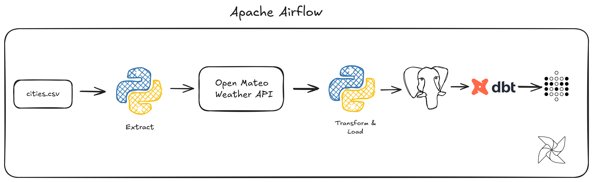

# Weatherly

An end-to-end ETL pipeline that extracts real-time weather data from the Open-Meteo API, transforms it using Python, loads it into PostgreSQL, models the data with dbt, and visualizes insights using Metabase. Apache Airflow orchestrates the complete workflow.

---

## Architecture



---

## Tech Stack

| Category | Technology |
|----------|------------|
| Orchestration | Apache Airflow |
| Programming | Python |
| API | Open-Meteo API |
| Database | PostgreSQL |
| Data Modeling | dbt |
| Dashboard | Metabase |
| Containerization | Docker |
| Data Processing | Pandas |
| Async Processing | aiohttp, asyncio |

---

## Project Structure

```text
Weather-ETL-Pipeline/
│
├── airflow/
├── analytics/
├── dags/
├── data/
├── src/
│   ├── extract.py
│   ├── transform.py
│   ├── load.py
│   └── utils.py
│
├── docker-compose.yml
├── requirements.txt
├── .gitignore
└── README.md
```

---


## Features

- Automated workflow orchestration with Apache Airflow
- Concurrent API requests using aiohttp and asyncio
- Weather data extraction from Open-Meteo API
- Data transformation and preprocessing with Pandas
- PostgreSQL data storage
- Data modeling using dbt
- Dashboard creation with Metabase
- Dockerized development environment

---

## Getting Started

### Clone the Repository

```bash
git clone https://github.com/<your-username>/Weather-ETL-Pipeline.git
cd Weather-ETL-Pipeline
```

### Install Dependencies

```bash
pip install -r requirements.txt
```

### Start Services

```bash
docker compose up -d
```

### Configure Environment Variables

Create a `.env` file.

```env
POSTGRES_USER=postgres
POSTGRES_PASSWORD=password
POSTGRES_DB=weather_db
POSTGRES_HOST=postgres
POSTGRES_PORT=5432
```

### Run Airflow

Open:

```
http://localhost:8080
```

Enable the DAG and trigger a pipeline run.


## License

This project is licensed under the MIT License.